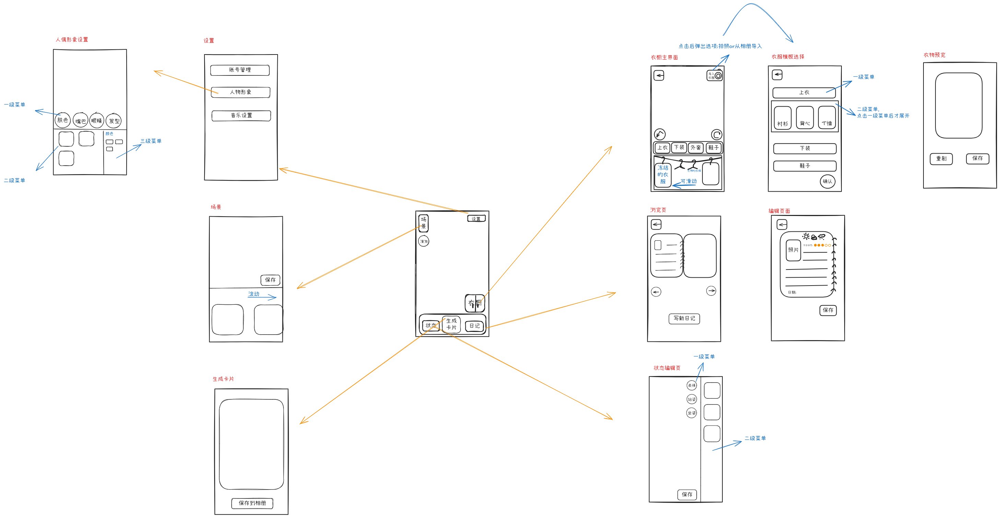

# 作品：换装衣橱 App 界面线框图

## 一句话简介
【手绘低保真线框图（wireframe）+ 页面流程图】用手绘线框图规划一个衣橱/换装搭配类 App 的页面结构与跳转关系，，作为后续 AI 前端开发的参考稿。

## 背景
为后面用 AI vibe coding 做前端做准备：先把页面画清楚，方便向 AI 表达需求、定位每个按钮的位置。

## 工具
- Excalidraw（手绘风白板，导出 .excalidraw / PNG）

## 包含的页面（共 11 个）
- 主页面：底部标签栏（首页/衣橱/搭配/探索）
- 人像分类查看：帽子/包包/上衣/下装/鞋子 分类
- 设置：账号管理 / 个性化设置 / 其他设置
- 场景页：保存 / 清除
- 生成卡片：保存到相册
- 衣服管理：上衣/裤子/裙子/袜子 分类，支持拖动排序
- 衣服智能选择：一键菜单
- 卡片编辑 / 贴纸编辑 / 卡片预览 / 状态编辑

## 作用
把这张图发给 AI，让它按图**还原页面布局**和**按钮位置**。

## 收获
画图过程倒逼自己把功能结构和跳转逻辑想清楚，比直接口述需求高效很多。

## 链接
- 源文件：换装衣橱设计图1.excalidraw（在仓库同目录）
